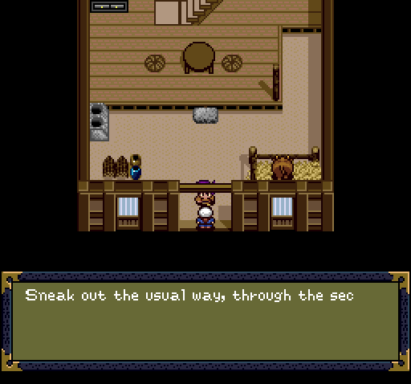
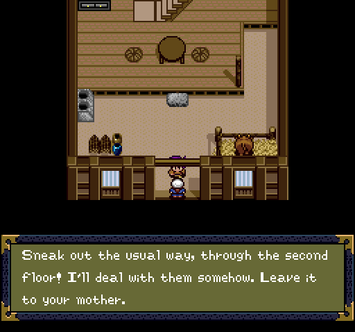
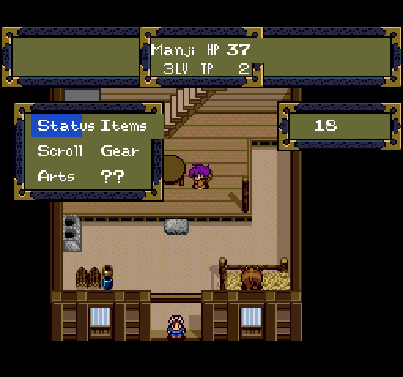
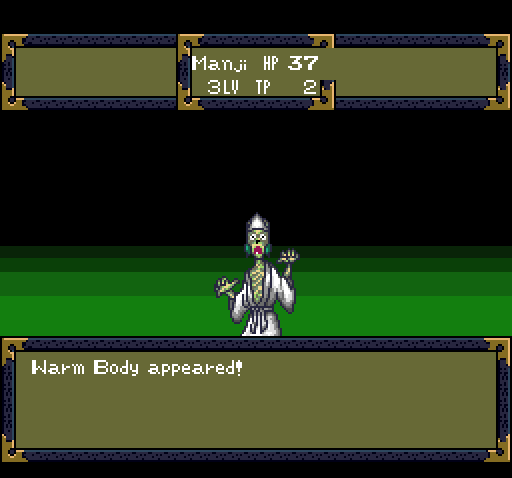
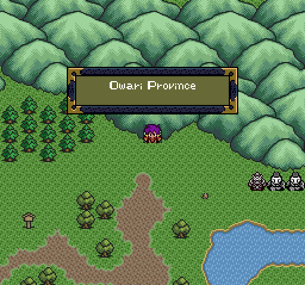
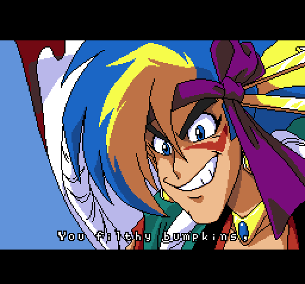
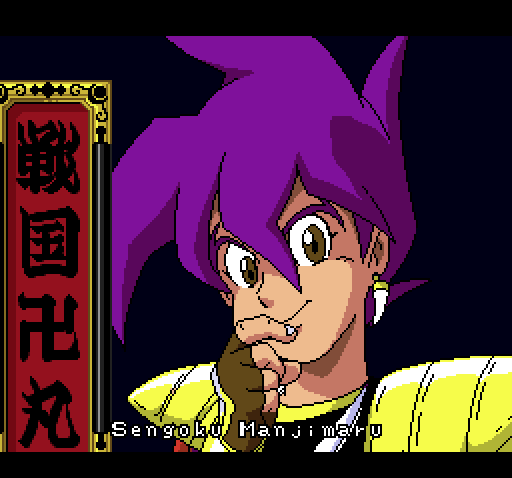
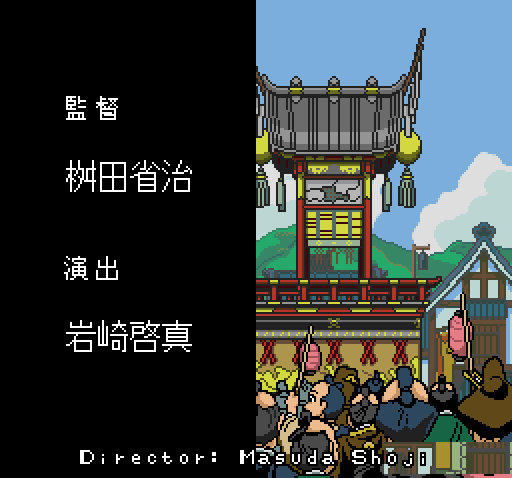

# Far East of Eden: Tengai Makyou II – Manji Maru (PC Engine Super CD-ROM²) — English Translation v0.9 beta

An English translation patch for **Tengai Makyou II: Manji Maru** (天外魔境II 卍MARU, Hudson / Red Company, 1992),
the PC Engine Super CD-ROM² RPG. It was never released in English, until now.

## Screenshots

## Download

Get the zip from the [v0.9-beta release](https://github.com/second-save/tengai-makyou-2-pce-cd/releases/tag/v0.9-beta).
It contains an xdelta patch and a README. The game is not included: patch your own image of the Japanese disc.

| Track 02 (data) | Size | CRC32 | SHA-1 |
|---|---|---|---|
| Japanese (input) | 232,109,472 | `e015c893` | `6098821244834d3cb630339a7028e7188b023f75` |
| English (output) | 232,109,472 | `afb17a76` | `bfe1b5c84f4f3aba10f8ffd588cf169d01fc5733` |

`Far East of Eden - Tengai Makyou II - Manji Maru (Japan) (Track 02).bin` from the Redump BIN/CUE set. Only the
data track changes: apply `TM2_EN_track02.xdelta` to it with [Delta Patcher](https://github.com/marco-calautti/DeltaPatcher)
or `xdelta3 -d -s <track 02> TM2_EN_track02.xdelta <output>`, put the output in place of Track 02 (same file name,
or edit the `.cue`), and keep the audio tracks as they are. Boot with the Super System Card 3.0.

Changed sectors have their Mode 1 EDC/ECC recomputed, so the image also suits real drives and optical-drive
emulators, not only emulators that ignore error correction.

## What's translated

- All 9,102 strings: story and NPC dialogue, menus, shops, inns, battles, items, spells, arts, monsters and bosses,
  signs, province banners, the start menu, the file screens and the ending credits
- English subtitles for the voiced cutscenes (189 lines over 7 scenes); the Japanese voice acting is kept
- The Japanese drawn as artwork stays as it is, with English captions underneath: the heroes' name cards, Kabuki's
  splash, the Manto 2 advert and the festival staff roll
- A variable-width font for the dialogue and menus

## Known issues (beta)

- In battle, the Guard submenu (Defend / Cover / Dodge) shows a stray kanji in front of "Defend".
- Some boss names are shortened to fit the game's 14-character name limit (Tenzen, Kuchinawa, Hamaguri...).
- Kabuki's second name card, in his entrance scene, has no caption.
- A few screens still need checking in play: two-column shop menus, some battle messages, one sign.

Tested in Mesen 2; not yet tested on real hardware or in Mednafen. Please open an issue for anything that looks
wrong, with a screenshot or a savestate if you can.

## This repository

The reverse-engineering notes (`docs/`) and the early analysis tools (`tools/`) from the start of the project:
Hudson pack decompression, sector map, Mesen helpers. No game data is included.
